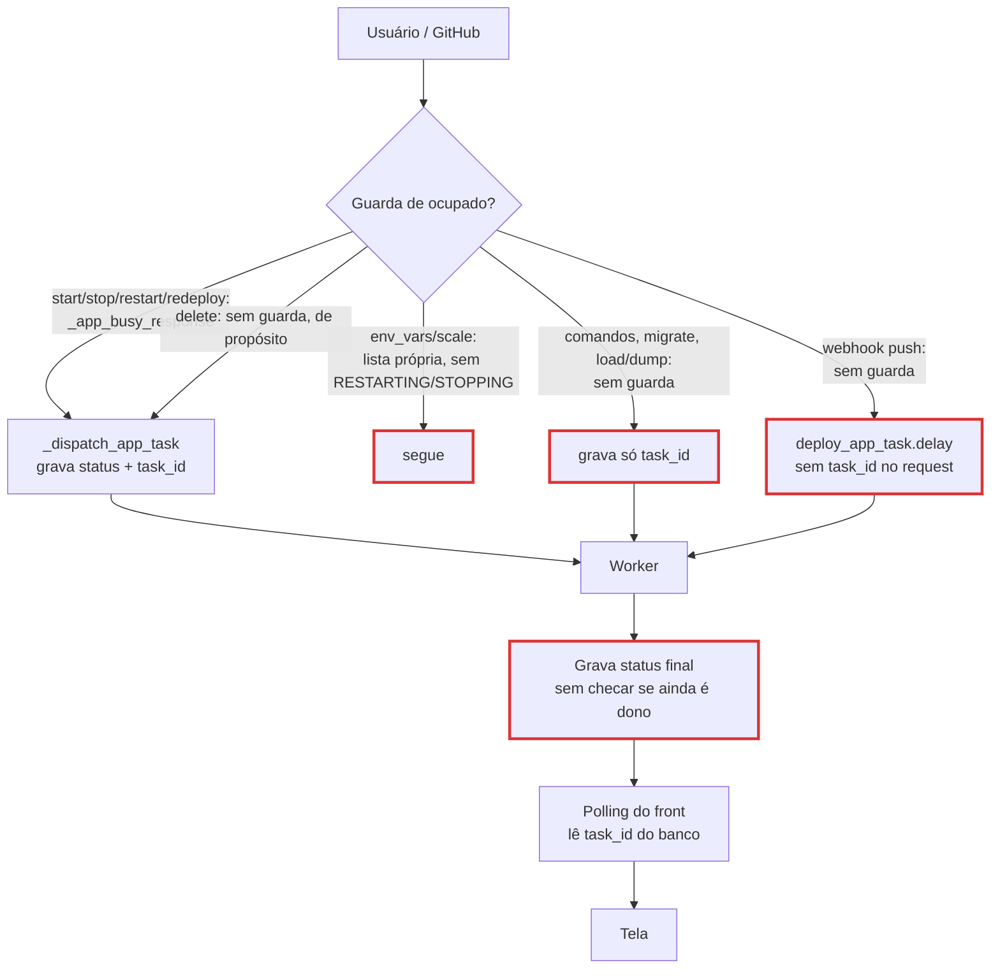

# Fluxo: ações concorrentes sobre um App

**Escopo:** o que acontece quando o usuário (ou o GitHub) dispara uma ação enquanto outra ainda está rodando: status gravado, `task_id`, Dokku, logs e tela.
**Fora do escopo:** o caminho feliz de cada ação isolada (está em `docs/flows/app-status-lifecycle`), CLI/MCP (usam os mesmos endpoints, então herdam o mesmo comportamento) e o deploy inicial (create).

Referências relativas à pasta `Fabroku/`, que contém os dois repositórios.

## Como o estado é compartilhado

Toda ação lê e grava os mesmos dois campos do `App`: `status` e `task_id`. A tela acompanha **só** o `task_id` gravado no banco, e o polling para no primeiro SUCCESS/FAILURE dessa task.

Legenda: contorno vermelho = ponto onde uma ação pode atropelar outra.

## Passos

| ID | Passo | Evidência | Tipo |
|----|-------|-----------|------|
| F1 | Guarda usada por start/stop/restart/redeploy: 409 se status transitório e a task não terminou | `Fabroku_Backend/src/applications/views.py:253-266` | verificado |
| F2 | Despacho grava `status` + `task_id` antes de enfileirar | `Fabroku_Backend/src/applications/views.py:269-280` | verificado |
| F3 | Delete não tem guarda (escape para app preso) | `Fabroku_Backend/src/applications/views.py:309-324` | verificado |
| F4 | Stop em DEPLOYING revoga com SIGTERM, loga aviso e grava RUNNING sem consultar o Dokku | `Fabroku_Backend/src/applications/views.py:375-397` | verificado |
| F5 | env_vars: 409 só em DEPLOYING/DELETING/STARTING; set/unset e restart rodam síncronos dentro da request | `Fabroku_Backend/src/applications/views.py:455-459` · `Fabroku_Backend/src/applications/views.py:479-511` | verificado |
| F6 | scale: 409 só em DEPLOYING/STARTING/DELETING; grava `task_id` da task de escala | `Fabroku_Backend/src/applications/views.py:589-593` · `Fabroku_Backend/src/applications/views.py:620-622` | verificado |
| F7 | run_command, migrate, loaddata, dumpdata: sem guarda; gravam `task_id` | `Fabroku_Backend/src/applications/views.py:732-735` · `Fabroku_Backend/src/applications/views.py:763-770` · `Fabroku_Backend/src/applications/views.py:799-806` · `Fabroku_Backend/src/applications/views.py:836-844` | verificado |
| F8 | Worker do comando grava `task_id` de novo quando começa | `Fabroku_Backend/src/applications/use_cases/run_command.py:89-90` | verificado |
| F9 | Webhook de push: só filtra branch e entrega duplicada; dispara deploy sem olhar status | `Fabroku_Backend/src/infrastructure/adapters/utils/git_webhook.py:74-82` · `Fabroku_Backend/src/infrastructure/adapters/utils/git_webhook.py:84-104` · `Fabroku_Backend/src/infrastructure/adapters/utils/git_webhook.py:119-120` | verificado |
| F10 | Deploy grava `task_id` + DEPLOYING só quando o worker começa | `Fabroku_Backend/src/applications/use_cases/deploy_app.py:85-91` | verificado |
| F11 | Deploy marca commit como pending no GitHub; só resolve no sucesso ou no except | `Fabroku_Backend/src/applications/use_cases/deploy_app.py:117-118` · `Fabroku_Backend/src/applications/use_cases/deploy_app.py:171-172` · `Fabroku_Backend/src/applications/use_cases/deploy_app.py:182-187` | verificado |
| F12 | Status final gravado sem condição (deploy, manage, delete) | `Fabroku_Backend/src/applications/use_cases/deploy_app.py:154-155` · `Fabroku_Backend/src/applications/use_cases/manage_app.py:83-89` · `Fabroku_Backend/src/applications/models.py:67-72` | verificado |
| F13 | Worker: 4 processos por container; vários containers `worker` em produção | `Fabroku_Backend/Procfile:3` | verificado (Procfile) · inferido (escala real) |
| F14 | Polling para no primeiro SUCCESS/FAILURE do `task_id` do banco | `Fabroku_Frontend/src/modules/applications/presentation/composables/use-app-task-polling.ts:34-50` | verificado |
| F15 | Botões: Parar e Excluir só desabilitam em DELETING; Reiniciar só habilita em RUNNING; Redeploy desabilita em transitório | `Fabroku_Frontend/src/components/projects/AppActionsCard.vue:36` · `Fabroku_Frontend/src/components/projects/AppActionsCard.vue:48` · `Fabroku_Frontend/src/components/projects/AppActionsCard.vue:60` · `Fabroku_Frontend/src/components/projects/AppActionsCard.vue:87` | verificado |
| F16 | Erro de qualquer ação (409, 400, 502) só vai para `console.error` | `[appId].vue` linhas 544-595 (handlers `handleDeleteApp`…`handleRedeployApp`) | verificado |
| F17 | Fora de status transitório a tela não consulta o backend: nada atualiza sozinho | `[appId].vue` linha 473 (watch só liga polling em transitório) | verificado |

## Matriz de cenários

"Tela" = página do app aberta. ✅ coerente · ⚠️ funciona com ressalva · ❌ estado errado ou travado.

| # | Cenário | Backend (status / task_id / Dokku) | Logs | Tela | |
|---|---------|-----------------------------------|------|------|---|
| C1 | Clique duplo em Reiniciar | 2º clique: 409 (F1) | só os do 1º restart | 2º clique sem retorno visível (F16) | ⚠️ |
| C2 | F5 no meio de qualquer ação | status + task_id já no banco (F2) | stream reabre pelo task_id | polling e card voltam | ✅ |
| C3 | Redeploy → Parar | revoke SIGTERM, grava RUNNING sem checar Dokku (F4); commit fica *pending* no GitHub (F11) | aviso "Redeploy cancelado" no log do deploy | card some, mostra RUNNING | ⚠️ / ❌ se o app estava STOPPED ou ERROR antes do redeploy |
| C4 | Reiniciar → Parar | 409 (F1) | — | sem retorno visível (F15, F16) | ⚠️ |
| C5 | Deploy rodando → Excluir | delete roda junto com o deploy; deploy pode gravar RUNNING por cima de DELETING (F12), delete destrói o app no meio do push | logs do deploy continuam no task antigo; a tela passa a mostrar os do delete | status pisca RUNNING/ERROR antes de sumir | ❌ |
| C6 | Deploy rodando → rodar comando / migrate | aceito (F7); `task_id` passa a ser o do comando | stream troca para o comando | polling termina com o comando, card "Fazendo deploy..." fica parado até F5; F5 não resolve até o deploy acabar | ❌ |
| C7 | C6 e depois Parar (cancelar) | stop revoga a task do **comando**, não o deploy; grava RUNNING; deploy segue e grava o status dele | aviso de cancelamento no log do comando | mostra RUNNING com deploy ainda rodando | ❌ |
| C8 | Reiniciar → mudar variável com "reiniciar" | aceito (F5); `ps:restart` síncrono na request corre junto com o restart da task | sem log de app (só auditoria SSH) | request pode ficar até ~2 min pendurada | ⚠️ |
| C9 | Reiniciar → escalar processos (via API/CLI; a tela bloqueia) | aceito (F6); `task_id` vira o da escala | — | polling acompanha a escala; card de restart fica parado | ❌ |
| C10 | Push no GitHub durante restart/stop | deploy roda em paralelo (F9); quem terminar por último define o status | dois task_ids gravando logs | tela segue o restart; deploy aparece só depois | ❌ |
| C11 | Dois pushes seguidos | dois deploys simultâneos no mesmo app; Dokku tende a recusar o 2º por lock → ERROR mesmo com o 1º ok | dois logs de deploy | status final depende da ordem | ❌ (inferido: lock do Dokku) |
| C12 | Push com app STOPPED | deploy sobe o app de novo (vira RUNNING) | normal | normal | ⚠️ decisão de produto |
| C13 | Push durante DELETING | deploy roda sobre app sendo destruído; falha ou grava status depois do soft delete | logs órfãos | — | ❌ |
| C14 | Duas abas / CLI / webhook mudam o app enquanto a tela está em RUNNING | — | — | tela não vê nada até F5 (F17) | ⚠️ |

## Estado gravado

| Campo | Quem grava | Quando | Condição |
|-------|-----------|--------|----------|
| `status` transitório | view (F2), webhook não | no request | guarda só em 4 endpoints |
| `task_id` | view (F2, F6, F7) e de novo o worker (F8, F10) | request e início da task | nenhuma |
| `status` final | worker (F12), view de stop (F4) | fim da task / cancelamento | nenhuma: último a escrever vence |

## O que já está bom (manter)

- Despacho grava `status` + `task_id` antes de enfileirar; F5 em qualquer momento recupera a tela (`Fabroku_Backend/src/applications/views.py:269-280`).
- Guarda de ocupado não trava app cuja task morreu com FAILURE/REVOKED (`Fabroku_Backend/src/applications/views.py:258-262`).
- Webhook deduplica reentregas do GitHub e libera a chave se não conseguir enfileirar (`Fabroku_Backend/src/infrastructure/adapters/utils/git_webhook.py:84-104` · `Fabroku_Backend/src/infrastructure/adapters/utils/git_webhook.py:121-128`).
- Falha ao apagar no Dokku mantém o app e avisa os admins, em vez de apagar só no banco (`Fabroku_Backend/src/applications/use_cases/delete_app.py:96-114`).

## Pontos não cobertos / perguntas

- O Dokku recusa um segundo `git:sync --build` no mesmo app enquanto o primeiro roda? (C11) Não li o comportamento de lock do Dokku instalado.
- `revoke(terminate=True)` mata o build no servidor ou só a conexão SSH? Se o build continuar no Dokku, o app pode subir com o código novo depois do "cancelado". (C3)
- Push com app parado deve religar o app (C12)? É decisão de produto, não bug.
