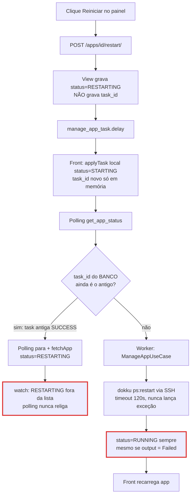

# Fluxo: ciclo de status do App (start / stop / restart)

**Escopo:** do clique em Iniciar/Parar/Reiniciar no painel até o status final gravado em `App.status` e exibido na tela.
**Fora do escopo:** deploy inicial (create), redeploy e delete em detalhe. Eles usam o mesmo padrão e aparecem só onde o problema se repete.

Referências relativas à pasta `Fabroku/`, que contém os dois repositórios.

## Diagrama

Legenda: contorno vermelho = ponto onde o status fica errado ou parado na tela.

## Passos

| ID | Passo | Evidência | Tipo |
|----|-------|-----------|------|
| F1 | Botão chama `handleRestartApp`, que chama `appActions.restart()` e liga o polling | `Fabroku_Frontend/src/pages/projects/[projectId]/[appId].vue:578-585` | verificado |
| F2 | Repositório faz `POST /apps/apps/{id}/restart/` | `Fabroku_Frontend/src/modules/applications/infrastructure/http/app-repository.ts:74-75` | verificado |
| F3 | View grava `status='RESTARTING'`; `task_id` não é gravado no App | `Fabroku_Backend/src/applications/views.py:389-411` | verificado |
| F3b | Mesmo padrão em start e stop (stop também sem `task_id`) | `Fabroku_Backend/src/applications/views.py:315-337` · `Fabroku_Backend/src/applications/views.py:370-386` | verificado |
| F4 | `task_id` só é gravado quando o worker pega a task | `Fabroku_Backend/src/applications/use_cases/manage_app.py:56-57` | verificado |
| F5 | Front troca o status local de restart para `STARTING` (não `RESTARTING`); stop nem liga polling | `Fabroku_Frontend/src/modules/applications/presentation/composables/use-app-actions.ts:68-92` | verificado |
| F6 | `get_app_status` consulta `AsyncResult(app.task_id)` com o `task_id` do banco | `Fabroku_Backend/src/applications/views.py:639-648` | verificado |
| F7/F8 | Polling para no primeiro SUCCESS/FAILURE e chama `onCompleted` → `fetchApp` | `Fabroku_Frontend/src/modules/applications/presentation/composables/use-app-task-polling.ts:34-51` · `Fabroku_Frontend/src/pages/projects/[projectId]/[appId].vue:331-344` | verificado |
| F9 | Status que religam polling: só `STARTING`, `DELETING`, `DEPLOYING` | `Fabroku_Frontend/src/modules/applications/presentation/composables/use-app-task-polling.ts:18` · `Fabroku_Frontend/src/pages/projects/[projectId]/[appId].vue:469-481` | verificado |
| F10 | Use case aquece Postgres e roda `ps:restart` | `Fabroku_Backend/src/applications/use_cases/manage_app.py:66-75` | verificado |
| F11 | `_run_command` nunca lança: devolve string `Failed...`/`SSH Command Timeout...`/`SSH Connection Error...` | `Fabroku_Backend/src/infrastructure/adapters/ssh.py:125-168` · `Fabroku_Backend/src/infrastructure/adapters/ssh.py:81` | verificado |
| F12 | Use case grava status final sem checar o output | `Fabroku_Backend/src/applications/use_cases/manage_app.py:77-80` | verificado |
| F13 | Se o worker morrer (deploy do próprio Fabroku, OOM, hard time limit 30 min), ninguém tira o app do status transitório | `Fabroku_Backend/src/applications/use_cases/manage_app.py:88-92` · `Fabroku_Backend/src/config/settings.py:484` | inferido (depende do worker ser reiniciado no meio da task) |

## Estado gravado

| Campo | Quem grava | Quando |
|-------|-----------|--------|
| `App.status` = transitório | view | no request |
| `App.task_id` | worker (use case) | só quando a task começa |
| `App.status` = final | worker | fim da task, sem checar output |

Quem lê: `get_app_status` (usa `task_id` do banco) e o watch do front (usa `status`).

## O que já está bom (manter)

- Ações são assíncronas com 202 e `task_id`; request não fica preso no SSH (`Fabroku_Backend/src/applications/views.py:402-411`).
- SSH tem timeout de conexão e de comando, e auditoria de todo comando (`Fabroku_Backend/src/infrastructure/adapters/ssh.py:125-168`).
- Stop durante DEPLOYING cancela o redeploy de verdade (revoke) (`Fabroku_Backend/src/applications/views.py:344-366`).
- Redeploy e env_vars já bloqueiam com 409 durante operação em andamento (`Fabroku_Backend/src/applications/views.py:613-617`).

## Pontos não cobertos / perguntas

- Quanto tempo `ps:restart` leva nos apps maiores? Se passar de 120 s, cai no timeout e hoje vira RUNNING mesmo sem ter terminado.
- O worker Celery é reiniciado a cada deploy do `fabroku-api`? Se sim, tasks em andamento morrem e o app fica preso no status transitório.
